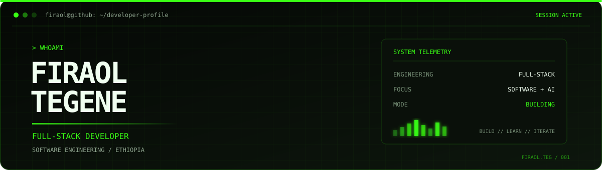

<!--
FIRAOL TEGENE // DEVELOPER CONTROL CENTER
GitHub: firaol-tag
Theme: Dark / Terminal Green
-->

<p align="center">
  
</p>

<div align="center">

[ `PROFILE` ](https://github.com/firaol-tag#profile) ·
[ `PROJECTS` ](https://github.com/firaol-tag#projects) ·
[ `EXPERIENCE` ](https://github.com/firaol-tag#experience) ·
[ `CONTACT` ](https://github.com/firaol-tag#contact)

</div>

---

<table>
<tr>
<td width="65%" valign="top">

### `~/about`

I'm **Firaol Tegene**, a Software Engineering graduate and Full-Stack Developer.

I engineer digital products, business systems, and backend solutions that turn complex workflows into practical software.

My work spans full-stack development, enterprise applications, AI-powered features, and IT infrastructure.

</td>
<td width="35%" valign="top">

### `system.info`

```text
USER      firaol
ROLE      Engineer
LOCATION  Ethiopia
EDUCATION BSc Software Eng.
STATUS    Building
```

</td>
</tr>
</table>

## `// PROJECTS`

<sub>SELECTED ENGINEERING WORK · 08 SYSTEMS</sub>

<table>
<tr>
<td width="50%" valign="top">

### `01 / WARAGUZO`

**Intercity Transportation**

A digital bus booking platform designed to simplify passenger travel and bus company operations in Ethiopia.

`SEARCH` `BOOKING` `QR TICKETS` `MULTI-ROLE`

<sub>STATUS: MVP DEVELOPMENT</sub>

</td>
<td width="50%" valign="top">

### `02 / KPIMS`

**Performance Intelligence**

A structured employee KPI management system supporting evaluation workflows, department performance, and commission processes.

`EVALUATION` `APPROVALS` `REPORTING`

<sub>DOMAIN: ENTERPRISE SYSTEMS</sub>

</td>
</tr>
<tr>
<td width="50%" valign="top">

### `03 / STOCK`

**Stock & Inventory Management**

An inventory control system designed to manage stock movements and establish accountable warehouse and finance workflows.

`STOCK-IN` `STOCK-OUT` `RETURNS` `APPROVALS`

<sub>DOMAIN: INVENTORY OPERATIONS</sub>

</td>
<td width="50%" valign="top">

### `04 / CRM`

**Customer Relationship Management**

A customer engagement platform for organizing customer data, managing communication workflows, and supporting business relationships.

`CUSTOMERS` `SEGMENTATION` `ENGAGEMENT`

<sub>DOMAIN: CUSTOMER OPERATIONS</sub>

</td>
</tr>
<tr>
<td width="50%" valign="top">

### `05 / G-POWER`

**Corporate Digital Platform**

Developed and maintained the corporate website, multilingual experience, product information, and customer-facing digital features.

`CORPORATE WEB` `SEO` `AI SUPPORT`

[OPEN LIVE PLATFORM ↗](https://gpower-et.com)

</td>
<td width="50%" valign="top">

### `06 / REGISTRAR`

**Student Registrar System**

Developed a digital registrar system to replace manual academic registration workflows during my development internship.

`STUDENT RECORDS` `REGISTRATION` `ADMIN`

<sub>IN USE · APPRECIATION CERTIFICATE</sub>

</td>
</tr>
<tr>
<td width="50%" valign="top">

### `07 / COURSE OFFERING`

**Rule-Based Course Management**

A team-developed system supporting structured course offering workflows for the Faculty of Computing and Software Engineering.

`RULE-BASED` `ACADEMIC WORKFLOWS`

<sub>IN USE · APPRECIATION CERTIFICATE</sub>

</td>
<td width="50%" valign="top">

### `08 / WARA TECHNOLOGY`

**Business Web Platform**

A contracted business website with a responsive interface and administrative dashboard for managing website content.

`BUSINESS WEB` `ADMIN DASHBOARD`

<sub>DELIVERED · LIVE PLATFORM</sub>

</td>
</tr>
</table>

## `// EXPERIENCE`

<table>
<tr>
<td width="24%" valign="top">

`2025 — NOW`

</td>
<td valign="top">

**IT Officer (Network & Fullstack)**

G-Power Manufacturing PLC · Five-Star Elevator Manufacturing PLC

- Full-stack development and internal business systems.
- Network, CCTV/NVR, telephone, and printer-sharing support.
- IT inventory management and documentation.
- HRM data updates and business technology operations.
- Website, LinkedIn, and customer engagement administration.

</td>
</tr>
<tr>
<td valign="top">

`INTERNSHIP`

</td>
<td valign="top">

**Full-Stack Developer**

Athlete Kenenisa Bekele Polytechnic College

Developed a student registrar management system, contributing to digital academic workflows and replacing manual processes.

</td>
</tr>
<tr>
<td valign="top">

`CONTRACT`

</td>
<td valign="top">

**Full-Stack Web Developer**

Wara Technology

Delivered a responsive business website and administrative dashboard.

</td>
</tr>
</table>

## `// ENGINEERING`

<p align="center">
  
</p>

<details>
<summary><code>EXPLORE ENGINEERING DOMAINS</code></summary>

```text
FRONTEND
  React · JavaScript · Responsive UI · Tailwind CSS

BACKEND
  Node.js · Express · REST APIs · Authentication

DATA
  MySQL · MongoDB · Database Design

TOOLS
  Git · GitHub · Postman · Figma · VS Code

EXPLORING
  Generative AI · RAG · Machine Learning
  Cloud Computing · DevOps · CI/CD
```

</details>

## `// GITHUB_TELEMETRY`

<p align="center">
  
</p>

<p align="center">
  
  
</p>

## `// CONTACT`

<p align="center">
  <a href="mailto:firaolteg46@gmail.com">
    
  </a>
  <a href="https://www.linkedin.com/in/firaol-tegene-a8461a232">
    
  </a>
</p>

<p align="center">
  <sub><code>BUILD WITH PURPOSE // ENGINEER WITH PRECISION</code></sub>
</p>

<p align="center">
  
</p>
